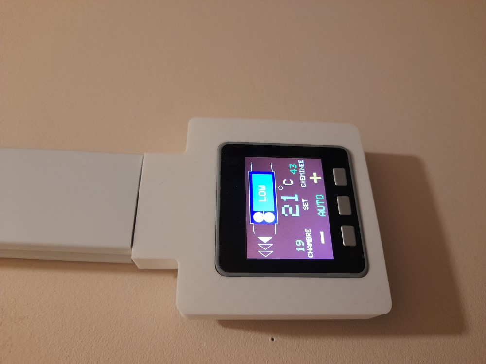
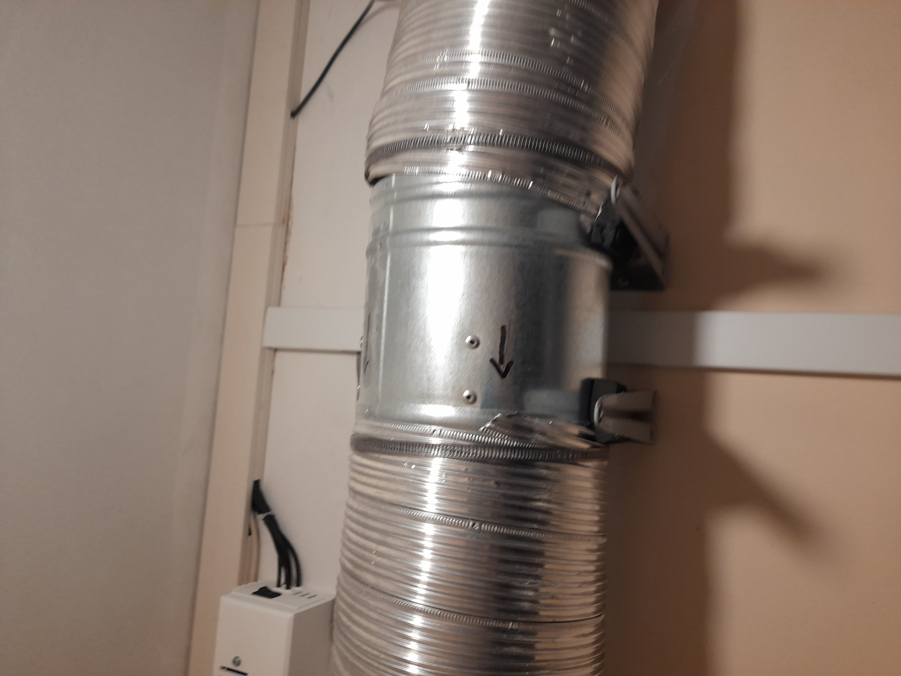
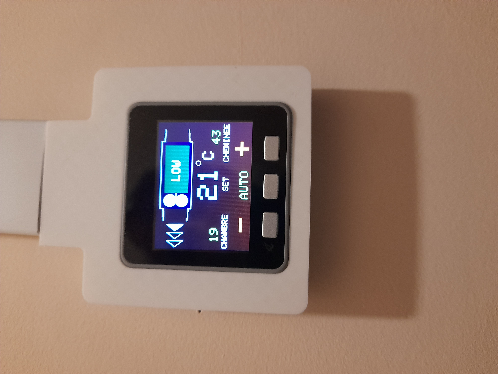

# Ventilateur de chauffage

This is a controller for a fan heating system. 

Controller : M5 Stack.

First, there is a chimney (wood fireplace) heating the house.

Then, heat is collected on top by a collector tube and a fan sends the hot air to a bedroom located in another room.
This is a heat exchanger, no connection with the fumes.
Choose a metallic AC fan, resistant to heat.

There is a temperature sensor in the inlet part of the collector tube. (T°in)

There is another temperature sensor in the bedroom.(T°out)

The controller is an M5stack. located anywhere far from the chimney.
The M5stack controls the Fan AC motor using a robotdynn dimmer module. It uses a triac BTA16 600B  (snubberless)

Beware to minimize wiring distance between M5 stack and robotdyn circuit, 1 m. max.
There are   3 speed used: MID, MED, HI  
M5 stack has 3 buttons to control  
      - mode: auto or manual mode, on the middle button
      
      -  + or - speed in manual
        
In case of duct overheat, the fans is automatically set to MAX to avoid overheat in the tubing. There are still a few plastic wires around the motor there !

It is important to use a metallic fan. Any plastic model would melt in this location. These are easily found on internet.

It is also important to have a good damping installation to avoid noise and vibrations. THis is a reason for the 3 speeds which have been adjusted to my model to minimize harmonics and noise.

These speeds can be adjusted in the software.

Details of wiring are documented inside the code.  
System works well and very satisfying.
